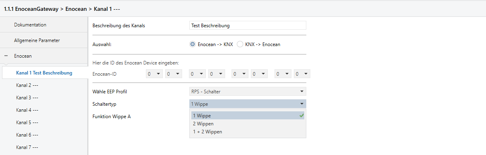

# Applikationsbeschreibung EnOcean-Gateway

Die Applikation EnOcean-Gateway verbindet EnOcean-Funkgeräte mit KNX. Sensoren, Taster, Kontakte, Zähler und Heizungsstellantriebe werden auf Kommunikationsobjekte (KO) abgebildet, EnOcean-Aktoren lassen sich von KNX aus schalten, dimmen und fahren.

Es stehen bis zu 30 Kanäle zur Verfügung, jeder Kanal ist für genau ein EnOcean-Gerät (eine EnOcean-ID) zuständig. Zusätzlich enthält die Applikation 50 Logikkanäle des OpenKNX-Logikmoduls, beschrieben in der [Applikationsbeschreibung Logik](https://github.com/OpenKNX/OFM-LogicModule/blob/v1/doc/Applikationsbeschreibung-Logik.md).

Eine Übersicht über die Konfigurationsseiten mit Links zur jeweiligen Beschreibung steht unter [ETS Konfiguration](#ets-konfiguration).

## Inhalte

* [Wichtige Hinweise](#wichtige-hinweise)
* [Änderungshistorie](#änderungshistorie)
* [Einleitung](#einleitung)
  * [EEP-Profil oder Hersteller](#eep-profil-oder-hersteller)
  * [Empfangs- und Sende-IDs](#empfangs--und-sende-ids)
* [ETS Konfiguration](#ets-konfiguration)
* [Kommunikationsobjekte](#kommunikationsobjekte)
* [Konsole](#konsole)
* [Inbetriebnahme und Update](#inbetriebnahme-und-update)
* [Beispiele](#beispiele)
* [Unterstützte Geräte](Supported-EnOcean-Devices.md)
* [Testcheckliste](Testcheckliste.md) und [Hinweise für die Weiterentwicklung](Entwicklung.md)

### ETS Konfiguration

* **+ [Allgemein](#allgemein)**
  * [Kanalauswahl](#kanalauswahl)
  * [Repeater](#repeater)
  * [Base-ID und Transceiver](#base-id-und-transceiver)
  * [Teach-In Übersicht](#teach-in-übersicht)
* **+ [Kanal n: ...](#kanal-n-) (n = 1 bis 30)**
  * [Kanaldefinition](#kanaldefinition)
  * [Einrichtung des Geräts](#einrichtung-des-geräts)
    * [ID manuell](#id-manuell)
    * [Teach-In](#teach-in)
  * [Über EEP-Profil](#über-eep-profil)
  * [Hersteller: ELTAKO](#hersteller-eltako)
  * [Taster](#taster)
    * [Schaltertyp und Zeit langer Tastendruck](#schaltertyp)
    * [Bedienung der Wippe](#bedienung-wippe-a--b--ab)
    * [Funktion der Wippe](#funktion-wippe-a--b--ab)
    * [Funktion der Taste (Einzeltasten)](#taste-oben--taste-unten)
    * [Taster KNX nach EnOcean](#taster-knx-nach-enocean)
  * [Fenster- und Türkontakte](#fenster--und-türkontakte)
  * [Alarm-Profile](#alarm-profile)
  * [Sensoren](#sensoren)
  * [Heizungsstellantriebe](#heizungsstellantriebe)
  * [Aktoren (KNX nach EnOcean)](#aktoren-knx-nach-enocean)
  * [Funksignal](#funksignal)
  * [Ausfallüberwachung](#ausfallüberwachung)

## Wichtige Hinweise

* Diese KNXprod wird nicht von der KNX Association offiziell unterstützt!
* Die Erzeugung der KNXprod geschieht auf Eure eigene Verantwortung!

## Änderungshistorie

### Beta 0.2 (Neuaufbau, nicht updatefähig)

Gegenüber den früheren Ständen wurde die Applikation umfassend erweitert. Die KO-Belegung hat sich geändert, **ein ETS-Update von älteren Versionen ist nicht möglich, das Gerät muss in der ETS neu eingefügt werden.** Eine im Gerät vorhandene alte Konfiguration wird beim Start erkannt, das Gerät startet dann unkonfiguriert und wartet auf die Programmierung.

* **20 KOs je Kanal** (bisher 11), Logikkanäle beginnen bei KO 620.
* **Taster:** Eltako-Taster als Produkte, Bedienung je Wippe als „Wippe“ oder „Einzeltasten“, kurzer und langer Tastendruck mit eigenen Funktionen und KOs, beide Wippen gleichzeitig (Wippe AB), Schaltertyp „1 Taste (F6-01-01)“, Schutz gegen doppelte Telegramme von Repeatern.
* **Neue Profile:** Raumbediengeräte A5-10, Zähler A5-12, Wetterstation A5-13, Digitaleingang A5-30, reiner CO2-Sensor A5-09-08/09, Hotelkartenschalter F6-04, Licht-Taster F6-02-03 auch KNX nach EnOcean.
* **Neue Eltako-Kategorien:** Raumregler, Wetterstation, Zähler sowie zahlreiche weitere Eltako-Geräte (siehe [Unterstützte Geräte](Supported-EnOcean-Devices.md)).
* **Funksignal-Diagnose** je Kanal (Signalstärke, Repeater-Stufe).
* **Alarm-Profile:** Alarm wahlweise nur setzen und über KNX zurücksetzen.
* **Fensterkontakte:** „Wert für geschlossen“ gilt für alle Zustands-KOs.
* **Hilfetexte** zu allen Kanalparametern in der ETS.
* **Korrekturen:** A5-09 über EEP-Profil, D5-00-01 (Kontakt auf KO3, Lerntelegramm), Eltako-Kontakte, FHD60SB, A5-12-01 (Nachkommastellen).

## Einleitung

Jedes EnOcean-Gerät sendet seine Werte als Funktelegramm mit einer festen, weltweit eindeutigen **EnOcean-ID**. Das Gateway ordnet jedes empfangene Telegramm über diese ID einem Kanal zu und wertet es nach dem eingestellten Profil aus. Telegramme von Geräten, die keinem Kanal zugeordnet sind, werden ignoriert und können über ein KO gemeldet werden.

### EEP-Profil oder Hersteller

Ein Kanal wird auf einem von zwei Wegen eingerichtet:

* **Über EEP-Profil:** Das EnOcean Equipment Profile (EEP) beschreibt, wie ein Gerät seine Daten im Telegramm codiert, z.B. „A5-04-02“ für Temperatur und Feuchte. Es steht in der Anleitung des Geräts. Dieser Weg funktioniert mit Geräten aller Hersteller.
* **Hersteller: ELTAKO:** Das Gerät wird direkt aus einer Liste gewählt. Viele Eltako-Geräte weichen in Details vom EEP-Standard ab (z.B. Sollwert als Temperatur, Seriennummer-Telegramme der Zähler). Diese Abweichungen berücksichtigt die Firmware nur auf diesem Weg.

Beide Wege nutzen im Hintergrund dieselbe Auswertung. Für Eltako-Geräte, die in der Liste stehen, sollte der Weg über **Hersteller: ELTAKO** gewählt werden.

### Empfangs- und Sende-IDs

* **Empfang:** Jeder Kanal kennt die ID seines Geräts, eingetragen von Hand oder per Teach-In.
* **Senden:** Für Aktoren (KNX nach EnOcean) sendet jeder Kanal mit einer eigenen Sende-ID: **Base-ID + Kanalnummer − 1**. Der Aktor lernt diese ID ein. Die Base-ID ist im Funkmodul (Transceiver) gespeichert, siehe [Base-ID und Transceiver](#base-id-und-transceiver).

## **Allgemein**

Hier werden Einstellungen vorgenommen, die für das gesamte Gateway gelten. Die allgemeinen OpenKNX-Einstellungen (z.B. Startverzögerung, In Betrieb senden) sind in der OpenKNX-Dokumentation beschrieben.

### **Kanalauswahl**

Die Tabelle zeigt alle 30 Kanäle mit **Kanaltyp** und **Beschreibung**. Hier wird ein Kanal aktiviert, indem man seinen Kanaltyp wählt:

* **Deaktiviert:** Der Kanal wertet nichts aus und hat keinen eigenen Tab.
* **über EEP-Profil** oder **Hersteller: ELTAKO:** Der Tab **Kanal n** erscheint, siehe [Kanaltyp](#kanaltyp).

Die Beschreibung ist dieselbe wie auf dem Kanal-Tab, Änderungen erscheinen an beiden Stellen. Die ETS zeigt nur die Tabs der aktiven Kanäle an, das hält die Anzeige schnell.

### **Repeater**

#### **Repeater-Function**

Das Gateway kann empfangene Funktelegramme wiederholen und so die Reichweite anderer Geräte vergrößern.

* **Nein:** keine Wiederholung
* **Ja:** empfangene Telegramme werden wiederholt (Umfang siehe Option)

Ein selektiver Repeater-Modus lässt sich nur über die Konsole einstellen (`eno repeater 2 L`).

#### **Option**

*Erscheint nur, wenn die Repeater-Function auf „Ja“ steht.*

* **Level 1:** Nur Telegramme, die noch nicht wiederholt wurden, werden wiederholt.
* **Level 2:** Auch bereits einmal wiederholte Telegramme werden wiederholt.

> Achtung: Level 2 nur nach sorgfältiger Prüfung der Funkverhältnisse einsetzen. Zu viele Wiederholungen führen zu Kollisionen und können die Funktion der gesamten Anlage beeinträchtigen.

### **Base-ID und Transceiver**

Die Base-ID ist der Startwert der Sende-IDs des Gateways (siehe [Empfangs- und Sende-IDs](#empfangs--und-sende-ids)). Jeder Transceiver hat ab Werk eine eigene Base-ID. Würde sich die Base-ID ändern, zum Beispiel nach einem Hardwaretausch, reagieren eingelernte Aktoren nicht mehr auf das Gateway. Deshalb wird sie in der ETS gespeichert.

#### **Base-ID und Transceiver-Info aus dem Gateway lesen** (Button)

Bei bestehender Online-Verbindung liest der Button die Base-ID aus dem Gateway und trägt sie in die Felder ein. Gleichzeitig wird **Base-ID aus der ETS in den Transceiver schreiben** eingeschaltet. Die Zeile **Transceiver** zeigt EURID, Firmware-Version und die verbleibenden Base-ID-Schreibzyklen. Anschließend die Applikation herunterladen.

#### **Base-ID aus der ETS in den Transceiver schreiben**

Ist diese Einstellung aktiv, vergleicht das Gateway bei jedem Start die Base-ID im Transceiver mit der aus der ETS. Weichen sie ab, schreibt es die Base-ID aus der ETS in den Transceiver. So bleiben die Sende-IDs auch nach einem Hardwaretausch gleich.

Zulässiger Bereich: FF800000 bis FFFFFF80, die unteren 7 Bit müssen 0 sein (128 Sende-IDs).

> Hinweis: Beim TCM 615 kann die Base-ID beliebig oft geändert werden, bei TCM 3xx/4xx nur 10-mal.

### **Teach-In Übersicht**

#### **Teach-In-Zeitfenster**

So lange wartet das Gateway nach **Teach-In starten** auf das Lerntelegramm des Geräts (30, 60 oder 120 s). Danach endet der Lernmodus automatisch.

#### **Status aller Kanäle abfragen** (Button)

Liest bei bestehender Online-Verbindung den Status aller aktiven Kanäle aus dem Gateway und zeigt ihn in der Tabelle an:

* **Deaktiviert:** Der Kanal ist in der Kanalauswahl deaktiviert.
* **ID manuell:** Der Kanal verwendet die von Hand eingetragene ID.
* **Nicht eingelernt / Eingelernt / Teach-In läuft / Fehler:** Status bei Kanälen mit Teach-In. Bei eingelernten Kanälen werden ID und Profil zusätzlich in den Kanal übernommen.

So ist vor dem Einlernen zu sehen, welche Kanäle noch frei sind.

## **Kanal n: ...**

Jeder aktive Kanal (siehe [Kanalauswahl](#kanalauswahl)) hat eine eigene Seite. Hinter „Kanal n:“ steht die [Beschreibung des Kanals](#beschreibung-des-kanals).

### **Kanaldefinition**

#### **Beschreibung des Kanals**

Freier Text. Er erscheint im Seitennamen des Kanals und vor den Namen der Kommunikationsobjekte. So lassen sich die Kanäle in der ETS leichter zuordnen, z.B. „Taster Flur“ oder „Fenster Bad“.

#### **Kanaltyp**

Derselbe Wert wie in der [Kanalauswahl](#kanalauswahl). Zum Deaktivieren eines Kanals dort **Deaktiviert** wählen.

* **über EEP-Profil:** siehe [Über EEP-Profil](#über-eep-profil)
* **Hersteller: ELTAKO:** siehe [Hersteller: ELTAKO](#hersteller-eltako)

### **Einrichtung des Geräts**

Legt fest, wie die EnOcean-ID des Geräts in den Kanal kommt. Beide Wege lassen sich jederzeit wechseln. Steht in den ID-Feldern eine ID, verwendet das Gateway diese.

#### **ID manuell**

Die 8-stellige EnOcean-ID wird von Hand eingetragen. Sie steht auf dem Gerät, in der Anleitung oder wird vom KO **IDs unbekannter Geräte** gemeldet. Verschlüsselte Geräte lassen sich so nicht einrichten, sie brauchen das Teach-In.

#### **Teach-In**

Die ETS muss online mit dem Gateway verbunden sein, die Applikation muss bereits einmal heruntergeladen worden sein.

1. **Teach-In starten:** Das Gateway öffnet den Lernmodus für diesen Kanal.
2. Innerhalb des Zeitfensters die Lerntaste am Gerät drücken. Bei Tastern ohne Lerntaste genügt ein Tastendruck.
3. **Ergebnis übernehmen:** Status, eingelernte ID und erkanntes Profil werden in den Kanal geschrieben.
4. Applikation herunterladen. Damit steht die ID fest im ETS-Projekt.

Bis zum Download arbeitet der Kanal bereits mit der im Gateway gespeicherten ID.

Als Lerntelegramm wird erkannt:

* 4BS- und 1BS-Geräte: Telegramm mit gesetztem Lern-Bit
* VLD-Geräte: UTE-Teach-In-Anfrage
* Taster ohne Lerntelegramm: erstes Telegramm eines noch unbekannten Senders
* Verschlüsselte Geräte: Secure Teach-In, der Transceiver übernimmt den Schlüssel

Ein bereits eingelernter Kanal kann nicht erneut eingelernt werden. Soll ein anderes Gerät in diesen Kanal, zuerst **Einlernung löschen**. Das entfernt die ID im Gateway, bei verschlüsselten Geräten auch den Schlüssel im Transceiver.

**Erkanntes Profil** zeigt das EEP, das das Gerät beim Einlernen gemeldet hat (bei 4BS mit Profilangabe und bei UTE). Passt der Telegrammtyp nicht zur Auswahl im Kanal, erscheint ein Hinweis. Das Profil wird nicht automatisch geändert.

### **Über EEP-Profil**

#### **Wähle EEP Profil**

Der Telegrammtyp, mit dem das Gerät sendet:

* **RPS - F6:** Schalter- und Zustandstelegramme (Fenstergriffe, Wassermelder, Hotelkartenschalter, Licht-Taster)
* **RPS - Schalter:** Taster und Wippenschalter, siehe [Taster](#taster)
* **1BS - D5:** Kontakte
* **4BS - A5:** Sensoren mit bis zu 4 Datenbytes (Temperatur, Feuchte, Helligkeit, Bewegung, Zähler, Raumbediengeräte, Heizungsstellantriebe ...)
* **VLD - D2:** Geräte mit variabler Datenlänge (Aktoren D2-01, Multisensoren, Fenstergriffe ...)

#### **EEP Profil**

Nach dem Telegrammtyp wird das genaue Profil gewählt, bei 4BS und VLD zuerst die Gruppe (z.B. „A5-04 Temperature and Humidity Sensor“) und dann der Typ (z.B. „A5-04-02“). Welche Profile ausgewertet werden, steht in der [Profilübersicht](../README.md).

#### **Auswahl (Richtung)**

*Erscheint bei RPS - Schalter und F6-02-03.*

* **Enocean -> KNX:** Telegramme des Tasters werden auf KNX ausgegeben.
* **KNX -> Enocean:** Der Kanal bildet einen Taster nach und steuert damit einen EnOcean-Aktor, siehe [Taster KNX nach EnOcean](#taster-knx-nach-enocean).

### **Hersteller: ELTAKO**

#### **Produkt-Kategorie**

Taster, Fenster/Tür-Kontakte, Umweltsensoren, Helligkeit/Dämmerungssensoren, Bewegungsmelder, Rauch/Hitzemelder, Heizungsstellaktoren, Wassersensoren, Aktoren, Raumregler, Wetterstation oder Zähler.

#### **Produkt**

Das Gerät aus der Liste der Kategorie. Danach zeigt die ETS nur die Einstellungen und KOs, die für dieses Gerät sinnvoll sind. Die vollständige Liste steht unter [Unterstützte Geräte](Supported-EnOcean-Devices.md).

> **Sechs- und Achtfach-Sender** (F6T…, FF8, FMH8) senden mit zwei IDs. Ein Kanal kann nur eine ID auswerten, deshalb gibt es pro Tastengruppe einen eigenen Produkteintrag, z.B. „FMH8 - Tasten 1-4 (1. ID)“ und „FMH8 - Tasten 5-8 (2. ID)“. Für jede Tastengruppe einen eigenen Kanal anlegen und mit einer Taste dieser Gruppe einlernen.

## **Taster**

Gilt für **RPS - Schalter** (Richtung Enocean -> KNX) und für die **Eltako-Taster**.

<kbd></kbd>

Ein Taster hat eine oder zwei Wippen. Jede Wippe hat eine obere und eine untere Taste. Die linke Wippe heißt **A**, die rechte **B**. Werden beide Wippen gleichzeitig gedrückt, ist das die **Wippe AB** mit eigener Funktion.

### **Schaltertyp**

*Nur beim EEP-Profil, bei Eltako-Tastern ergibt sich der Typ aus dem Produkt.*

* **1 Wippe:** Jede Taste wirkt auf Wippe A.
* **2 Wippen:** linke Wippe = A, rechte Wippe = B.
* **1 + 2 Wippen:** wie 2 Wippen, zusätzlich Wippe AB (beide gleichzeitig).
* **1 Taste (F6-01-01):** Taster mit nur einer Taste, Einstellungen wie „Wippe A, Taste oben“.

### **Zeit langer Tastendruck**

Haltezeit (300 bis 500 ms), ab der ein Tastendruck als lang gilt. Gilt für alle Wippen und Tasten des Kanals.

### **Bedienung Wippe A / B / AB**

* **Wippe (oben/unten gemeinsam):** Eine Funktion für die ganze Wippe, z.B. oben EIN, unten AUS.
* **Einzeltasten (oben und unten getrennt):** Taste oben und Taste unten sind unabhängig und haben eigene Funktionen und KOs, z.B. oben „Tor öffnen“, unten „Licht Einfahrt“.

Die Umstellung gilt immer für beide Tasten der Wippe. Bei Tastern ohne Wippen (1 Taste, 6- und 8-fach-Sender) gibt es nur Einzeltasten.

### **Funktion Wippe A / B / AB**

*Erscheint bei Bedienung „Wippe“.*

| Funktion | oben | unten | KOs |
|---|---|---|---|
| Schalten - EIN/AUS bzw. AUS/EIN | EIN (bzw. AUS) beim Drücken | AUS (bzw. EIN) beim Drücken | Schalten |
| Dimmen - Heller/Dunkler bzw. Dunkler/Heller | kurz EIN, lang heller | kurz AUS, lang dunkler | Schalten, Dimmen |
| Jalousie - AUF/AB bzw. AB/AUF | lang AUF, kurz Stopp/Lamelle | lang AB, kurz Stopp/Lamelle | AUF/AB, Stopp/Lamelle |
| Szene - a/b | Szene a | Szene b | Szene |

Beim Dimmen startet der lange Tastendruck das Dimmen, das Loslassen stoppt es.

#### **Szene a / Szene b**

*Erscheint bei Funktion Szene.* Szenennummer 1 bis 64 für die obere bzw. untere Taste.

### **Taste oben / Taste unten**

*Erscheint bei Bedienung „Einzeltasten“. Bei Tastern mit einer Taste heißt der Parameter „Funktion Taste“.*

| Funktion | kurzer Tastendruck | langer Tastendruck |
|---|---|---|
| Umschalten | jeder Druck schaltet um | wählbar |
| Gedrückt | Drücken = 1, Loslassen = 0 (einstellbar) | wählbar |
| Szene | Szene (oben Szene a, unten Szene b) | wählbar |
| Dimmen | Umschalten | Dimmen, Richtung wechselt bei jedem langen Druck |
| Jalousie | Stopp/Lamelle | Fahren, Richtung wechselt bei jedem langen Druck |

* **Umschalten:** Das KO ist beschreibbar, damit es den aktuellen Zustand vom Bus übernimmt (z.B. die Statusrückmeldung des Aktors). Der nächste Druck schaltet davon ausgehend um.
* **Dimmen:** Bei ausgeschaltetem Licht wird immer heller gedimmt.
* Umschalten und Gedrückt nutzen dasselbe KO. Die Gruppenadressen bleiben beim Wechsel zwischen beiden erhalten.

#### **Langer Tastendruck**

*Erscheint bei Umschalten, Gedrückt und Szene.* Der lange Tastendruck sendet auf dem zweiten KO der Taste:

* **keine (sofort beim Drücken):** Die Taste reagiert sofort beim Drücken.
* **Umschalten / EIN senden / AUS senden:** z.B. für Zentral-AUS.
* **Szene:** mit eigener Szenennummer (**Szene lang**).

Ist ein langer Tastendruck eingestellt, wird der kurze Druck erst beim Loslassen ausgeführt, wenn die Zeit für den langen Tastendruck noch nicht abgelaufen ist.

#### **Beim Loslassen senden**

*Erscheint bei Gedrückt.* **Ja:** Beim Loslassen wird der Gegenwert gesendet (Taster-Verhalten). **Nein:** Es wird nur beim Drücken gesendet. Mit langem Tastendruck folgt der Gegenwert direkt nach dem kurzen Druck (kurzer Impuls).

#### **Invertiert (Drücken = 0, Loslassen = 1)**

*Erscheint bei Gedrückt.* Kehrt die gesendeten Werte um.

### **Doppelte Telegramme**

EnOcean-Repeater senden jedes Telegramm ein zweites Mal. Ein zweites „Gedrückt“ derselben Taste innerhalb von 250 ms wird deshalb verworfen. Sonst würde z.B. „Umschalten“ zweimal schalten.

### **Taster KNX nach EnOcean**

*Erscheint bei RPS - Schalter mit Auswahl „KNX -> Enocean“.*

Der Kanal bildet einen EnOcean-Taster nach. Über das Eingangs-KO (KO0) wird ein Aktor per Funk gesteuert.

#### **Rocker Funktion**

* **Schalten - EIN/AUS:** EIN = Taste oben, AUS = Taste unten
* **Dimmen:** Taste wird gedrückt gehalten, bis Stopp empfangen wird (spätestens 10 s)
* **Jalousie - AB/AUF:** AUF/AB = Taste kurz tippen, Stopp = erneut in der letzten Richtung tippen

#### **Lerntelegramm an Aktor senden** (Button)

1. Den Aktor in den Lernmodus bringen (siehe Anleitung des Aktors).
2. Bei bestehender Online-Verbindung den Button drücken. Das Gateway sendet einen Tastendruck oben mit der Sende-ID dieses Kanals.
3. Den Lernmodus am Aktor beenden.

Ohne ETS geht das auch über die Konsole mit `eno learn <Kanal>`.

Beim Profil **F6-02-03 (Licht-Taster)** mit Richtung KNX -> Enocean gilt: KO0 1 = heller dimmen, 0 = dunkler dimmen, KO1 1 = Licht EIN, 0 = Licht AUS. Der Button sendet „Licht EIN“ als Lerntelegramm.

## **Fenster- und Türkontakte**

Gilt für Fenstergriffe und Kontakte (F6-10-00/01, A5-14, D5-00-01, A5-30 und die entsprechenden Eltako-Produkte).

| KO | Funktion |
|---|---|
| KO1 | Fenster offen |
| KO2 | Fenster gekippt |
| KO3 | offen/geschlossen |

### **Wert für geschlossen**

Gilt für alle Zustands-KOs. Im Ruhezustand (geschlossen) wird dieser Wert gesendet, bei aktivem Zustand (offen bzw. gekippt) der invertierte.

Voreinstellung ist **1** (DPT 1.009: 1 = geschlossen). Damit senden „offen“ und „gekippt“ im aktiven Zustand eine 0. Wer bei offenem Fenster eine 1 erwartet, stellt **0** ein.

## **Alarm-Profile**

Gilt für Rauch-, Wind- und Wassermelder (F6-05), Fenstergriff-Alarm (D2-06), Rauchmelder D2-14-30 und die Eltako-Melder FRWB, FHMB und FWS81. Das Alarm-KO ist KO3 (DPT 1.005).

### **Alarm zurücksetzen**

* **automatisch (Alarm aufgehoben = 0 senden):** Meldet das Gerät, dass der Alarm aufgehoben ist, sendet das KO eine 0.
* **nur Alarm senden (Zurücksetzen über KNX):** Das KO sendet nur die 1 und bleibt auf 1, bis es über KNX zurückgesetzt wird, z.B. von einer Person in der Visualisierung. Sinnvoll, wenn ein Alarm bewusst quittiert werden muss.

## **Sensoren**

Die KOs hängen vom Profil bzw. Produkt ab, die ETS zeigt nur die passenden an. Wo möglich stehen gleiche Messgrößen auf demselben KO (z.B. Temperatur KO1, Feuchte KO2).

| Profil | KOs |
|---|---|
| Temperatur/Feuchte (A5-02, A5-04) | KO1 Temperatur, KO2 Feuchte |
| Raumbediengerät A5-10 | KO1 Temperatur, KO2 Feuchte, KO3 Sollwert-Stellrad (%), KO4 Lüfterstufe (0..3, 4 = Auto), KO5 Präsenztaste, KO6 Tag/Nacht, KO7 Kontakt |
| Zähler A5-12 | KO6 Zählerstand (Impulse, kWh bzw. m³), KO7 aktueller Wert (Impulse/s, W bzw. l/h), KO9 Tarif bzw. Messkanal |
| Wetterstation A5-13 | KO1 Außentemperatur, KO3 Dämmerung (lx), KO4 Wind (m/s), KO5 Regen, KO6 Tag/Nacht, KO7..KO9 Sonne West/Süd/Ost (lx) |
| Digitaleingang A5-30 | KO3 Kontakt, KO4 Batterie schwach |
| Hotelkartenschalter F6-04 | KO0 Karte gesteckt |

Bei Raumbediengeräten über **EEP-Profil** ist der Sollwert laut EEP nur eine Stellrad-Position („Min … Max“) ohne Einheit. Er wird in Prozent ausgegeben, die Umrechnung in °C hängt vom Gerät ab. Bei den **Eltako-Raumreglern** kommt die Solltemperatur direkt in °C (KO3), dazu Nachtabsenkung (KO4) und bei FUTH Feuchte und Soll-Feuchte (KO2, KO5).

Bei den Eltako-Zählern werden die Seriennummer-Telegramme, die alle 10 Minuten gesendet werden, verworfen.

## **Heizungsstellantriebe**

Die Stellantriebe A5-20-01 (z.B. Eltako FKS-SV), A5-20-04 (z.B. Eltako FKS-B, FKS-H) und A5-20-06 arbeiten **bidirektional**: Sie wachen zyklisch auf, senden ihre Werte und hören danach kurz zu. Das Gateway antwortet in diesem Moment mit dem Sollwert. Werte von KNX werden deshalb nicht sofort, sondern mit dem nächsten Telegramm des Antriebs übertragen.

Nach einem Neustart des Gateways antwortet es erst, wenn ein Sollwert per KNX empfangen wurde.

Die Einstellungen und KOs je Profil sind in der ETS-Hilfe zum jeweiligen Profil ausführlich beschrieben.

## **Aktoren (KNX nach EnOcean)**

Das Gateway steuert EnOcean-Aktoren per Funk. Den Aktor vorher mit **Lerntelegramm an Aktor senden** einlernen (Aktor in den Lernmodus bringen, dann den Button drücken). Die Bestätigungstelegramme des Aktors werden als Status zurückgemeldet.

### **Schalt- und Dimmaktoren (A5-38-08)**

Über EEP-Profil „A5-38 Central Command“ oder als Eltako-Produkt (Kategorie Aktoren). Für Eltako-Aktoren den Weg über **Hersteller: ELTAKO** nutzen, da Eltako den Zentralbefehl abweichend auslegt.

#### **Einschaltwert (0 = letzter Wert)**

*Nur Dimmaktoren.* Dimmwert beim Einschalten über das Schalt-KO. 0 = der zuletzt gesetzte Wert.

#### **Dimmrampe / Dimmgeschwindigkeit**

*Nur Dimmaktoren.* EEP-Aktoren: Rampe in Sekunden bis 100 % (0 = ohne Rampe). Eltako-Aktoren: 0 = Einstellung am Drehschalter des Aktors, 1 = schnell bis 255 = langsam.

### **Jalousie- und Rollladenaktoren (Eltako)**

#### **Fahrzeit ganz auf bis ganz zu**

Zeit, die der Behang von der oberen bis zur unteren Endlage braucht. Daraus berechnet das Gateway Zwischenpositionen. Fahrten in eine Endlage bekommen 10 % Reserve. Eine Zwischenposition kann erst angefahren werden, wenn die Position bekannt ist, also nach einer Fahrt in eine Endlage.

### **D2-01 Aktoren**

Schalt- und Dimmaktoren nach VLD D2-01, je nach Typ mit Messung von Energie und Leistung. Eingelernt wird per UTE. Sende-Modus, Einheiten, Änderungsschwellen und Sendeintervalle der Messung sind in der ETS einstellbar, die Messkonfiguration wird einige Sekunden nach dem Start an den Aktor gesendet.

## **Funksignal**

### **Funksignal-Diagnose**

Gibt für jedes empfangene Telegramm des Geräts die Funkqualität aus. Hilft bei der Inbetriebnahme, z.B. um den besten Platz für Gateway, Antenne oder Repeater zu finden.

* **aus:** keine Ausgabe
* **bei jedem Telegramm senden**
* **nur bei Änderung senden:** ab 3 dBm Änderung oder anderer Repeater-Stufe

| KO | Funktion |
|---|---|
| KO17 | Signalstärke in dBm (DPT 6.010), z.B. -65 |
| KO18 | Repeater-Stufe (DPT 5.010): 0 = direkt empfangen, 1 oder 2 = über einen bzw. zwei Repeater |

Richtwerte: besser als -70 dBm gut, -70 bis -85 dBm ausreichend, schlechter als -85 dBm kritisch.

## **Ausfallüberwachung**

### **Ausfall melden nach**

Meldet über KO19 **Gerät ausgefallen** (DPT 1.005), wenn vom Gerät länger als die eingestellte Zeit kein Telegramm empfangen wurde. Typische Ursachen: leere Batterie, zu wenig Licht bei Solarsensoren, Gerät außer Reichweite.

* **aus:** keine Überwachung
* **1 bis 48 h:** Zeit ohne Telegramm, nach der der Ausfall gemeldet wird

Sobald das Gerät wieder sendet, geht das KO auf 0. Viele Sensoren senden zyklisch alle 15 bis 60 Minuten, dann passt z.B. 2 bis 4 h. Kontakte und Taster senden oft nur bei Betätigung, dort ist die Überwachung nur mit langen Zeiten sinnvoll.

## Kommunikationsobjekte

### Allgemein

| KO | Name | Funktion |
|---|---|---|
| 8 | IDs unbekannter Geräte | meldet die ID von Geräten, die keinem Kanal zugeordnet sind (DPT 16.001) |
| 9 | aktiviert Kanal zum Einlernen | startet das Teach-In per KNX: 1 bis 30 = Kanal, 255 = beenden, 100 = aktiven Kanal abfragen |
| 10 | Channel bereit zum Einlernen | meldet den Kanal, der gerade einlernt (0 = keiner) |

### Kanäle

Jeder Kanal hat 20 KOs. Die KO-Nummer berechnet sich aus **20 + (Kanal − 1) × 20 + KO**, Kanal 1 hat also die Nummern 20 bis 39, Kanal 2 die Nummern 40 bis 59.

| KO | Belegung |
|---|---|
| KO0 bis KO16 | je nach Profil, siehe die Abschnitte oben |
| KO17 | Signalstärke |
| KO18 | Repeater-Stufe |
| KO19 | Gerät ausgefallen |

#### KO-Belegung Taster

Alle KOs einer Wippe stehen untereinander.

| KO | Bedienung „Wippe“ | Bedienung „Einzeltasten“ |
|---|---|---|
| KO0 | Wippe A: Schalten / AUF-AB / Szene | A oben: kurz |
| KO1 | Wippe A: Dimmen / Stopp-Lamelle | A oben: lang / Dimmen / Stopp |
| KO2 | – | A unten: kurz |
| KO3 | – | A unten: lang / Dimmen / Stopp |
| KO4 | Wippe B: Schalten / AUF-AB / Szene | B oben: kurz |
| KO5 | Wippe B: Dimmen / Stopp-Lamelle | B oben: lang / Dimmen / Stopp |
| KO6 | – | B unten: kurz |
| KO7 | – | B unten: lang / Dimmen / Stopp |
| KO8 | Wippe AB: Schalten / AUF-AB / Szene | AB oben: kurz |
| KO9 | Wippe AB: Dimmen / Stopp-Lamelle | AB oben: lang / Dimmen / Stopp |
| KO10 | – | AB unten: kurz |
| KO11 | – | AB unten: lang / Dimmen / Stopp |

### Logik

Die Logikkanäle beginnen bei KO 620.

## Konsole

Über die USB-Konsole (OpenKNX-Konsole) stehen folgende Befehle zur Verfügung:

| Befehl | Funktion |
|---|---|
| `eno monitor on` / `off` | jedes empfangene Funktelegramm anzeigen (nach dem Start eingeschaltet) |
| `eno signal` | letzte Signalstärke und Repeater-Stufe je Kanal |
| `eno teach N` / `off` / `?` / `list` / `del N` | Teach-In für Kanal N starten, beenden, abfragen, eingelernte Kanäle anzeigen, Einlernung löschen |
| `eno learn N` | Lerntelegramm von Kanal N an einen Aktor senden |
| `eno baseid` / `eno baseid FFxxxxxx` | Base-ID lesen bzw. schreiben |
| `eno repeater` / `eno repeater M L` | Repeater lesen bzw. Modus M (0..2) und Level L (0..2) schreiben |
| `eno version` | Version und EURID des Transceivers |

Eine Zeile des Telegramm-Mitschnitts sieht so aus:

```
RX R-ORG F6 | ID FEF12345 | CH3 | -67 dBm | Repeater 0 | Security 0 | Status 30 | Data: 70
```

R-ORG ist der Telegrammtyp, CH der Kanal mit dieser ID („kein Kanal“, wenn die ID keinem Kanal zugeordnet ist).

## Inbetriebnahme und Update

1. Firmware auf das Gerät laden (USB oder KNX, siehe Release).
2. KNXprod mit dem Skript aus dem Release erzeugen und in die ETS importieren.
3. Gerät in der ETS einfügen, physikalische Adresse vergeben, Kanäle einrichten und die Applikation herunterladen.
4. Geräte per Teach-In einlernen oder IDs von Hand eintragen, danach erneut herunterladen.

Firmware und Applikation müssen zusammenpassen. Meldet die ETS beim Download, dass Firmware und Applikation nicht zusammenpassen, die Firmware aus demselben Release flashen.

Passt die im Gerät gespeicherte Konfiguration nicht zur Firmware (z.B. nach einem Wechsel auf eine nicht updatefähige Version), startet das Gerät unkonfiguriert und zeigt in der Konsole „KO table has … entries“. Dann einfach die Applikation mit der ETS neu herunterladen.

## Beispiele

### Taster: kurz Licht, lang Zentral-AUS

Ein Taster mit einer Wippe soll oben kurz das Licht umschalten, oben lang alle Lichter ausschalten, unten das Tor öffnen.

* Bedienung Wippe A: **Einzeltasten**
* Taste oben: **Umschalten**, Langer Tastendruck: **AUS senden**
  * KO0 (A oben kurz) mit der Licht-Gruppenadresse verbinden, dazu die Statusadresse des Aktors (damit Umschalten den aktuellen Zustand kennt)
  * KO1 (A oben lang) mit der Zentral-AUS-Gruppenadresse verbinden
* Taste unten: **Gedrückt**, Beim Loslassen senden: **Nein**
  * KO2 (A unten kurz) mit der Tor-Gruppenadresse verbinden

### Fensterkontakt mit 1 = offen

Die Visualisierung erwartet bei offenem Fenster eine 1. **Wert für geschlossen** auf **0** stellen. Dann sendet KO3 bei geschlossenem Fenster 0 und bei offenem 1.

### Funkreichweite prüfen

Für einen Sensor mit schlechtem Empfang **Funksignal-Diagnose** auf „bei jedem Telegramm senden“ stellen und KO17/KO18 in der Visualisierung anzeigen, oder in der Konsole `eno signal` aufrufen. Werte schlechter als -85 dBm oder eine Repeater-Stufe größer 0 deuten auf einen ungünstigen Standort hin.
